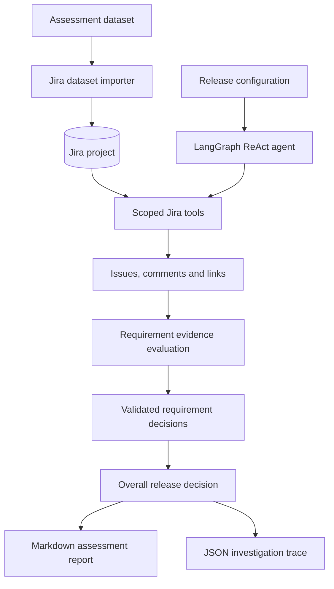

# TYN Release Evidence Agent

[](https://www.python.org/)
[](https://www.langchain.com/langgraph)
[](https://www.atlassian.com/software/jira)
[](#tests)

An evidence-grounded AI agent that investigates software release requirements using Jira, evaluates linked issues and comments against a target release configuration, and generates an auditable release-readiness assessment.

A practical demonstration of evidence-grounded release-readiness analysis using Jira and AI agents.

> **Latest recorded assessment: BLOCKED** — 4 requirements passed, 4 failed, and 4 had insufficient evidence. The agent reports the evidence it finds rather than treating missing information as a pass.

## Contents

- [What it does](#what-it-does)
- [Architecture](#architecture)
- [Technology stack](#technology-stack)
- [Key design decisions](#key-design-decisions)
- [Project structure](#project-structure)
- [Setup](#setup)
- [Import the Jira dataset](#import-the-jira-dataset)
- [Run the agent](#run-the-agent)
- [Output artifacts](#output-artifacts)
- [Assessment results](#assessment-results)
- [Model usage and runtime](#model-usage-and-runtime)
- [Tests](#tests)
- [Known limitations](#known-limitations)

## What it does

The project has two stages:

1. **Dataset import:** imports the supplied assessment records into a dedicated Jira project, maps source IDs to Jira keys, imports comment text, and creates issue relationships. The current importer does not preserve original comment authors, roles, or event timestamps as Jira comment metadata.
2. **Evidence investigation:** a LangGraph ReAct agent retrieves scoped Jira evidence, investigates release requirements, validates the model's response structure, and produces requirement-level and overall decisions.

The agent's Jira tools retrieve issue descriptions, comments, and linked issues. The generated report includes decisions, explanations, supporting Jira references, and outstanding verification.

## Architecture

### End-to-end flow



### Main components

| Component | Responsibility |
|---|---|
| `src/import_jira.py` | Imports dataset issues, comments, and relationships into Jira |
| `src/src/agent.py` | Runs the LangGraph ReAct investigation workflow |
| `src/src/jira_tools.py` | Provides issue retrieval and dataset-scoped Jira search |
| `reports/` | Stores the assessment report and source-to-Jira issue mapping |
| `traces/` | Stores the JSON investigation trace |

The assessment agent uses Jira as its evidence source; it does not read the original dataset directly during investigation.

## Technology stack

- **Language:** Python 3.12
- **Agent orchestration:** LangChain, LangGraph
- **LLM:** Google Gemini (`gemini-3.5-flash-lite`)
- **External system:** Jira Cloud REST API
- **Configuration and HTTP:** Requests, python-dotenv
- **Testing:** Pytest

## Key design decisions

- **Jira as the evidence source:** investigations retrieve evidence from Jira, the system where release evidence is maintained.
- **Dataset-scoped retrieval:** searches are constrained by the configured Jira project and dataset label; retrieved results receive additional filtering.
- **Structured response checks:** model responses are parsed and checked for required sections and valid decision values. Validation failures fail closed to `INSUFFICIENT_EVIDENCE`.
- **Bounded retries and pagination:** Jira retrieval supports pagination and bounded retries for transient failures, including rate limits, server errors, timeouts, and connection failures.
- **Conservative release decisions:** a failed requirement blocks the release; insufficient evidence requires review; readiness is returned only when required evidence is complete and no failures or unresolved evidence issues remain.

## Project structure

```text
tyn-release-agent/
|-- reports/
|   |-- assessment_R2.4.md
|   |-- issue_mapping.json
|-- src/
|   |-- import_jira.py
|   |-- test_gemini_tools.py
|   |-- src/
|       |-- agent.py
|       |-- jira_tools.py
|       |-- test_jira_tool.py
|-- traces/
|   |-- assessment_R2.4.json
|-- .env.example
|-- .gitignore
|-- pytest.ini
|-- requirements.txt
|-- README.md
```

The original assessment PDF and source dataset are not included. Obtain `dataset.json` from the supplied assessment ZIP and place it in `inputs/` before running the importer.

## Setup

Python 3.12 is recommended. The commands below use PowerShell.

Create and activate a virtual environment:

```powershell
python -m venv venv
.\venv\Scripts\Activate.ps1
```

Install dependencies:

```powershell
python -m pip install -r requirements.txt
```

Create a `.env` file using `.env.example` as a template:

```env
JIRA_BASE_URL=https://your-domain.atlassian.net
JIRA_EMAIL=your-email@example.com
JIRA_API_TOKEN=your-jira-api-token
JIRA_PROJECT_KEY=TYN
GOOGLE_API_KEY=your-google-api-key
```

Use your own authorized Jira and Google API credentials. Never commit `.env` or expose API tokens.

## Import the Jira dataset

The importer expects the assessment dataset at `inputs/dataset.json`.

For a fresh Jira project, import issues and comments:

```powershell
python .\src\import_jira.py --limit 400
```

After source records have been mapped, create relationships:

```powershell
python .\src\import_jira.py --limit 400 --links
```

The completed assessment import contains:

| Imported data | Count |
|---|---:|
| Jira issues | 400 |
| Comments | 2,059 |
| Jira relationships | 76 |

The importer writes the source-ID-to-Jira-key mapping to `reports/issue_mapping.json`.

> **Caution:** Avoid rerunning imports against an already populated project without first verifying existing issues, comments, and relationships.

## Run the agent

From the project root, with the virtual environment activated:

```powershell
python .\src\src\agent.py
```

Or pass the assessment configuration explicitly:

```powershell
python .\src\src\agent.py --project-key TYN --dataset-label tyn-release-assessment-v2 --manifest-key TYN-360 --release R2.4 --commit b7a91f2 --prompt p7 --environment production --service atlas-assistant
```

The recorded assessment configuration:

| Parameter | Value |
|---|---|
| Jira project | `TYN` |
| Dataset label | `tyn-release-assessment-v2` |
| Release | `R2.4` |
| Commit | `b7a91f2` |
| Prompt version | `p7` |
| Environment | `production` |
| Service | `atlas-assistant` |
| Release manifest | `TYN-360` |

## Output artifacts

| Artifact | Description |
|---|---|
| `reports/assessment_R2.4.md` | Requirement IDs, Jira references, decisions, explanations, supporting evidence, and outstanding verification |
| `traces/assessment_R2.4.json` | Release configuration, requirement investigations, model usage information, and execution details |
| `reports/issue_mapping.json` | Mapping from source dataset IDs to Jira issue keys |

## Assessment results

Latest recorded run for release `R2.4`:

| Requirement decision | Count |
|---|---:|
| PASS | 4 |
| FAIL | 4 |
| INSUFFICIENT_EVIDENCE | 4 |

**Overall release decision: BLOCKED**

The assessment found release-blocking failures and requirements for which the available evidence was insufficient to establish compliance. This is the agent's assessment result, not a claim that the software release itself was deployed or changed.

## Model usage and runtime

| Metric | Recorded value |
|---|---:|
| Model | `gemini-3.5-flash-lite` |
| Model calls | 41 |
| Input tokens | 123,970 |
| Output tokens | 5,888 |
| Total tokens | 129,858 |
| Runtime | 265.92 seconds |

Source: `traces/assessment_R2.4.json`.

## Tests

Run the test suite from the project root:

```powershell
python -m pytest -q
```

Latest recorded result: **36 passed**.

## Known limitations

- Requirements are iterated from a predefined list in code; the agent does not independently discover all requirements from Jira.
- The manifest key and target configuration values are passed as inputs rather than dynamically read from the Jira manifest.
- Jira search is capped at the configured page limit of 20 pages.
- Gemini free-tier quotas and rate limits can interrupt execution.
- Evidence citations are model-written text and are not independently validated by code.
- Importer reruns have limitations; verify existing issues, comments, and relationships before rerunning to avoid duplicates.
- Testing has been performed against the supplied assessment dataset only.
- LLM-generated assessments can vary between runs and should be reviewed against Jira evidence.
