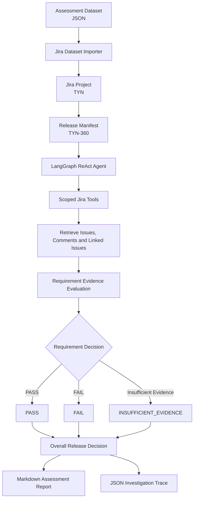

# AI-Powered Release Readiness & Evidence Agent

An AI-powered Jira Release Evidence Agent developed for The Yellow Network AI Engineer Assessment.

The agent investigates software release requirements using Jira evidence, evaluates linked issues and comments against a target release configuration, and generates an evidence-based release-readiness report.

## 1. Technology Stack

- Python 3.12
- LangChain and LangGraph
- Google Gemini (`gemini-3.5-flash-lite`)
- Jira Cloud REST API
- Requests
- python-dotenv
- Pytest

## 2. Architecture




The application consists of two main stages.

### Jira Dataset Import

`src/import_jira.py` imports the supplied assessment dataset into a dedicated Jira project.

It:
- Creates Jira issues from source records.
- Preserves source IDs and record details in Jira descriptions.
- Imports comments while retaining original fictional event text.
- Preserves scenario actor, role, and event timestamp in comment bodies.
- Creates Jira relationships after issue import.
- Saves source-ID-to-Jira-key mappings in `reports/issue_mapping.json`.

The assessment agent retrieves evidence from Jira rather than reading the source dataset directly.

### AI Evidence Investigation

`src/src/agent.py` implements a LangGraph ReAct agent.

The investigation workflow:

1. Retrieves the release manifest from Jira.
2. Identifies mandatory linked requirements.
3. Investigates requirements using Jira tools.
4. Retrieves relevant issue descriptions, comments, and linked issues.
5. Evaluates evidence against the target release configuration.
6. Produces a decision, explanation, supporting evidence, and outstanding verification.
7. Calculates the overall release decision.
8. Saves the assessment report and investigation trace.

### Jira Tools

Implemented in `src/src/jira_tools.py`:

- `get_jira_issue`: retrieves an issue, comments, and linked issues.
- `search_jira_issues`: searches issues within the configured project and assessment dataset scope.

## 3. Design Choices

### Jira as the evidence source

The agent retrieves evidence from Jira instead of directly querying the imported dataset. This keeps the investigation aligned with the system where release evidence is maintained.

### Dataset-scoped searches

Jira searches are constrained by the configured project and dataset label. Additional filtering is applied to retrieved results to reduce the risk of investigating unrelated issues.

### Response validation

The agent parses fixed-format model responses, checks required sections and decision values programmatically, and fails closed to `INSUFFICIENT_EVIDENCE` when validation fails.

### Bounded API retries and pagination

Jira retrieval supports pagination and bounded retries for transient failures, including rate limits, server errors, timeouts, and connection failures.

### Conservative release decisions

The overall decision follows an evidence-first approach:

- Any requirement marked `FAIL` results in `BLOCKED`.
- Missing or insufficient evidence results in `NEEDS_REVIEW` when no requirement has failed.
- `READY` is returned only when the required evidence is complete and no failures or unresolved evidence issues remain.

This prevents missing evidence from being interpreted as a successful release check.

## Project structure

```text
tyn-release-agent/
|-- inputs/
|   |-- dataset.json (provided separately)
|-- reports/
|   |-- assessment_R2.4.md
|   |-- issue_mapping.json
|-- .github/
|   |-- workflows/
|       |-- tests.yml
|-- src/
|   |-- import_jira.py
|   |-- test_import_jira.py
|   |-- test_gemini_tools.py
|   |-- src/
|       |-- agent.py
|       |-- jira_tools.py
|       |-- test_jira_tool.py
|-- traces/
|   |-- assessment_R2.4.json
|-- .env.example
|-- .gitignore
|-- pytest.ini
|-- requirements.txt
|-- README.md
```

The original assessment PDF and source dataset are not included. Obtain `dataset.json` from the supplied assessment ZIP and place it in `inputs/` before running the importer.

## Setup

Python 3.12 is recommended. The commands below use PowerShell.

Create and activate a virtual environment:

```powershell
python -m venv venv
.\venv\Scripts\Activate.ps1
```

Install dependencies:

```powershell
python -m pip install -r requirements.txt
```

Create a `.env` file using `.env.example` as a template:

```env
JIRA_BASE_URL=https://your-domain.atlassian.net
JIRA_EMAIL=your-email@example.com
JIRA_API_TOKEN=your-jira-api-token
JIRA_PROJECT_KEY=TYN
GOOGLE_API_KEY=your-google-api-key
```

Use your own authorized Jira and Google API credentials. Never commit `.env` or expose API tokens.

## Import the Jira dataset

The importer expects the assessment dataset at `inputs/dataset.json`.

For a fresh Jira project, import issues and comments:

```powershell
python .\src\import_jira.py --limit 400
```

After source records have been mapped, create relationships:

```powershell
python .\src\import_jira.py --limit 400 --links
```

The completed assessment import contains:

| Imported data | Count |
|---|---:|
| Jira issues | 400 |
| Comments | 2,059 |
| Jira relationships | 76 |

The importer writes the source-ID-to-Jira-key mapping to `reports/issue_mapping.json`.

> **Caution:** Avoid rerunning imports against an already populated project without first verifying existing issues, comments, and relationships.

## Run the agent

From the project root, with the virtual environment activated:

```powershell
python .\src\src\agent.py
```

Or pass the assessment configuration explicitly:

```powershell
python .\src\src\agent.py --project-key TYN --dataset-label tyn-release-assessment-v2 --manifest-key TYN-360 --release R2.4 --commit b7a91f2 --prompt p7 --environment production --service atlas-assistant
```

The recorded assessment configuration:

| Parameter | Value |
|---|---|
| Jira project | `TYN` |
| Dataset label | `tyn-release-assessment-v2` |
| Release | `R2.4` |
| Commit | `b7a91f2` |
| Prompt version | `p7` |
| Environment | `production` |
| Service | `atlas-assistant` |
| Release manifest | `TYN-360` |

## 8. Output Artifacts

### Assessment report

`reports/assessment_R2.4.md`

Contains requirement IDs, Jira references, decisions, explanations, supporting evidence, and outstanding verification.

### Investigation trace

`traces/assessment_R2.4.json`

Contains release configuration, requirement investigations, model usage information, and execution details.

### Issue mapping

`reports/issue_mapping.json`

Maps source dataset IDs to their corresponding Jira issue keys.

## Assessment results

Latest recorded run for release `R2.4`:

| Requirement decision | Count |
|---|---:|
| PASS | 4 |
| FAIL | 4 |
| INSUFFICIENT_EVIDENCE | 4 |

**Overall decision: BLOCKED**

The assessment found release-blocking failures and requirements for which the available evidence was insufficient to establish compliance. This is the agent's assessment result, not a claim that the software release itself was deployed or changed.

## Model usage and runtime

| Metric | Recorded value |
|---|---:|
| Model | `gemini-3.5-flash-lite` |
| Model calls | 41 |
| Input tokens | 123,970 |
| Output tokens | 5,888 |
| Total tokens | 129,858 |
| Runtime | 265.92 seconds |

Source: `traces/assessment_R2.4.json`.

## Tests

Run `python -m pytest -q` from the project root. Latest recorded result: **36 passed**.

## Known limitations

- Requirement discovery is manifest-driven: the agent retrieves the configured Jira manifest and assesses its linked requirement issues. It does not independently discover unlinked requirements across the Jira project.
- Target release attributes (release, commit, prompt, environment, and service) are supplied as CLI inputs; they are not currently derived from or cross-validated against fields in the Jira manifest.
- Jira search is capped at the configured page limit of 20 pages.
- Gemini free-tier quotas and rate limits can interrupt execution.
- Evidence citations are model-written text and are not independently validated by code.
- Importer reruns have limitations; verify existing issues, comments, and relationships before rerunning to avoid duplicates.
- Automated tests use mocked Jira responses; a live Jira integration test is not part of the default test suite.
- LLM-generated assessments can vary between runs and should be reviewed against Jira evidence.